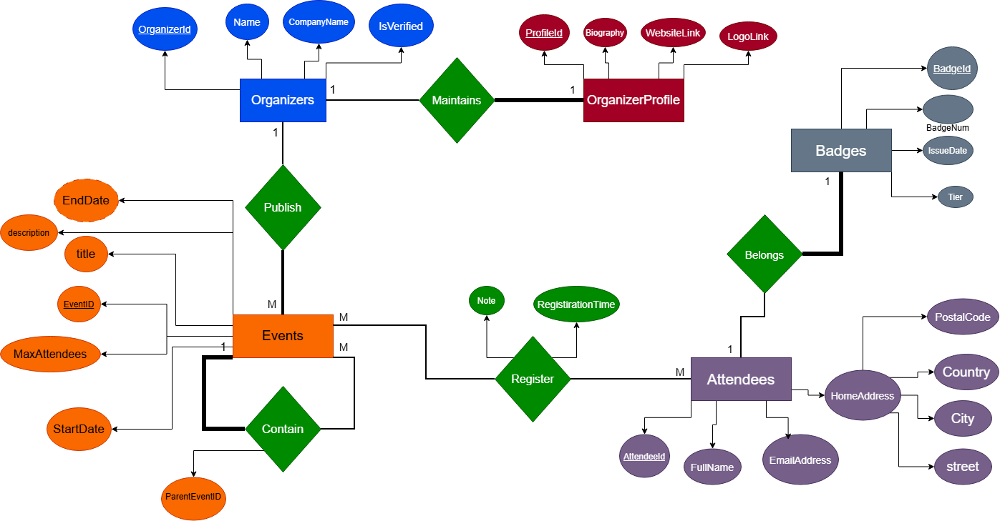
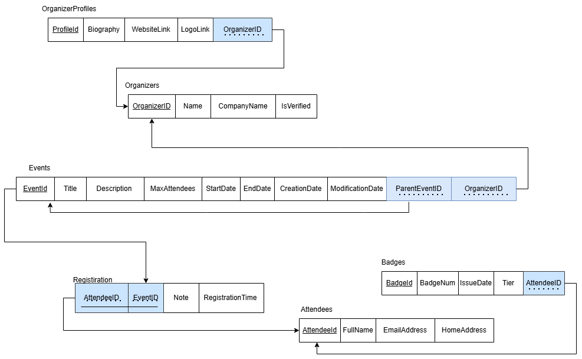
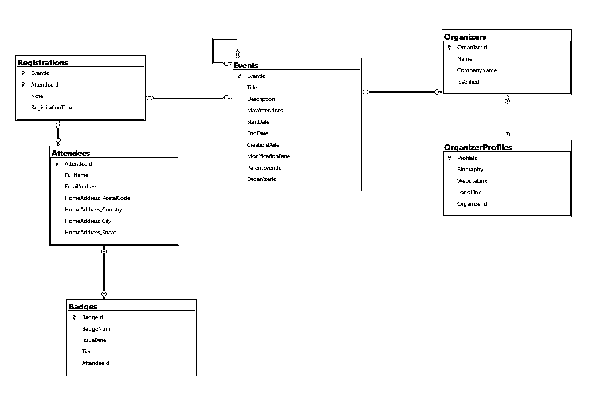

# EventHub

**EventHub** is a C#/.NET console application that models the data layer of an event-management platform. It represents organizers and their profiles, events and nested sessions, attendees, event registrations, and attendee badges.

The project uses **Entity Framework Core (EF Core) with SQL Server** to define the relational model, configure entity mappings, and manage database schema changes through code-first migrations.

## Overview

EventHub includes the following domain capabilities:

- Organizers with verification status and a one-to-one public profile.
- Events published by organizers, including optional end dates and nested sessions.
- Attendees with contact information and an owned home address.
- Event registrations with an optional note and registration timestamp.
- Optional attendee badges with an issue date, badge number, and `Standard` or `VIP` tier.

## EF Core Implementation

The project demonstrates multiple EF Core configuration techniques and relational mapping features.

| Feature | Implementation |
| --- | --- |
| Code-first workflow | Entity classes and model configuration define the schema, with migrations tracking schema changes. |
| Data Annotations | Used in `Organizer` and `Badge` for property constraints and foreign-key metadata. |
| Fluent API | Used in `AppDbContext.OnModelCreating` for `OrganizerProfile` and `Registration`. |
| Entity configuration classes | `AttendeeConfiguration` and `EventConfiguration` implement `IEntityTypeConfiguration<T>`. |
| Owned type | `Address` is configured with `OwnsOne` and mapped into the `Attendees` table. |
| Shadow properties | `CreationDate` and `ModificationDate` are defined for `Event` without being CLR properties on the entity class. |
| Composite primary key | `Registration` uses `EventId` and `AttendeeId` as its key. |
| Indexes and constraints | Required fields, maximum lengths, a unique index on attendee email, and optional properties are configured. |
| Database defaults | The registration timestamp is configured with the SQL default `GETDATE()`. |
| Relationship behaviors | One-to-one, one-to-many, self-referencing, and join-entity relationships are configured with explicit delete behaviors where needed. |

### Entity Configuration Details

| Entity / Feature | Configuration | Key mappings |
| --- | --- | --- |
| `Organizer` | Data Annotations | Required `Name`, maximum lengths, optional `CompanyName`, and verification status. |
| `Badge` | Data Annotations | Required `BadgeNum`, maximum length, and foreign-key metadata for the badge owner. |
| `Attendee` | `AttendeeConfiguration` | Table and primary key, required name and email, maximum lengths, and a unique index on `EmailAddress`. |
| `Address` | Owned type in `AttendeeConfiguration` | Street, city, country, and postal code are required and assigned maximum lengths. No separate address table is needed. |
| `Event` | `EventConfiguration` | Title and description constraints, required start date and capacity, optional end date, shadow properties, organizer relationship, and self-referencing session relationship. |
| `OrganizerProfile` | Fluent API in `OnModelCreating` | Table name, primary key, biography and link constraints, and required one-to-one relationship with `Organizer`. |
| `Registration` | Fluent API in `OnModelCreating` | Table name, composite primary key, optional note, and SQL default for the registration timestamp. |

### Event Timestamp Shadow Properties

The event configuration defines two required shadow properties:

```csharp
builder.Property<DateTime>("CreationDate").IsRequired();
builder.Property<DateTime>("ModificationDate").IsRequired();
```

These properties are part of the EF Core model and database schema, but they are not declared as regular properties on the `Event` class. Their values must be set and maintained by the persistence logic or another database mechanism.

## Domain Model

| Entity | Responsibility |
| --- | --- |
| `Organizer` | Organizer identity, company name, verification status, events, and profile. |
| `OrganizerProfile` | Biography, website link, and logo link for an organizer. |
| `Event` | Event details, dates, maximum attendees, organizer, parent event, and child sessions. |
| `Attendee` | Attendee identity and contact details, owned address, registrations, and optional badge. |
| `Address` | Value data for an attendee's home address. |
| `Registration` | Associative entity linking an attendee to an event, including registration-specific fields. |
| `Badge` | Badge number, issue date, tier, and owning attendee. |
| `BadgeTier` | Enum defining `Standard` and `VIP` tiers. |

## Database Relationships

| Relationship | Type | Mapping details |
| --- | --- | --- |
| `Organizer` → `OrganizerProfile` | One-to-one | `OrganizerProfile` has a required `OrganizerId` foreign key. |
| `Organizer` → `Event` | One-to-many | An organizer can publish multiple events; each event references an organizer. |
| `Event` → `Event` | Self-referencing one-to-many | A parent event can contain multiple sessions; each session can reference one parent event. |
| `Attendee` → `Badge` | Optional one-to-one from attendee | An attendee can have at most one badge; each badge references one attendee. |
| `Attendee` ↔ `Event` | Many-to-many through `Registration` | `Registration` uses the composite key `(EventId, AttendeeId)` and stores the note and registration timestamp. |
| `Attendee` → `Address` | Owned type | The address is owned by the attendee and stored as columns in the `Attendees` table. |

Delete behavior is configured for selected relationships: the organizer-profile and parent-event relationships use `Restrict`, while the event-to-organizer relationship uses `Cascade`.

## ERD and Database Diagrams

### Entity Relationship Diagram



### EF Core Mapping Diagram



### SQL Server Schema



The SQL Server schema illustrates how the entities and relationships are represented as tables, keys, and foreign keys. The attendee's owned address is mapped to columns in `Attendees`, and the event shadow properties are represented in the `Events` table.

## Project Structure

```text
EventHub/
├── Configurations/
│   ├── AttendeeConfiguration.cs
│   └── EventConfiguration.cs
├── files/
│   ├── EventHub Bussiness Rules.pdf
│   ├── EventHub-ERD.png
│   ├── EventHub-Mapping.png
│   └── EventHub-SQLServerSchema.png
├── Migrations/
├── Models/
│   ├── Enums/
│   │   └── BadgeTier.cs
│   ├── Address.cs
│   ├── Attendee.cs
│   ├── Badge.cs
│   ├── Event.cs
│   ├── Organizer.cs
│   ├── OrganizerProfile.cs
│   └── Registration.cs
├── AppDbContext.cs
├── EventHub.csproj
└── Program.cs
```

## Repository Assets

The `EventHub/files` directory contains the business rules document, ERD, mapping diagram, and SQL Server schema image used to describe the database design.
